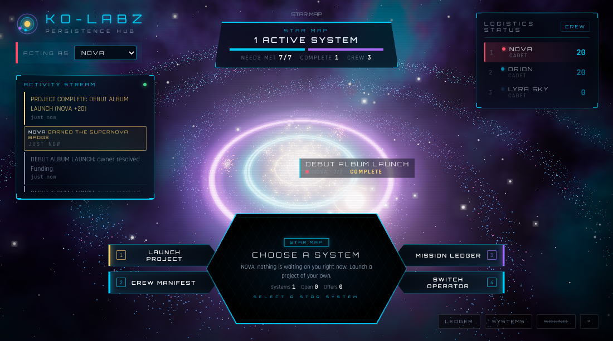
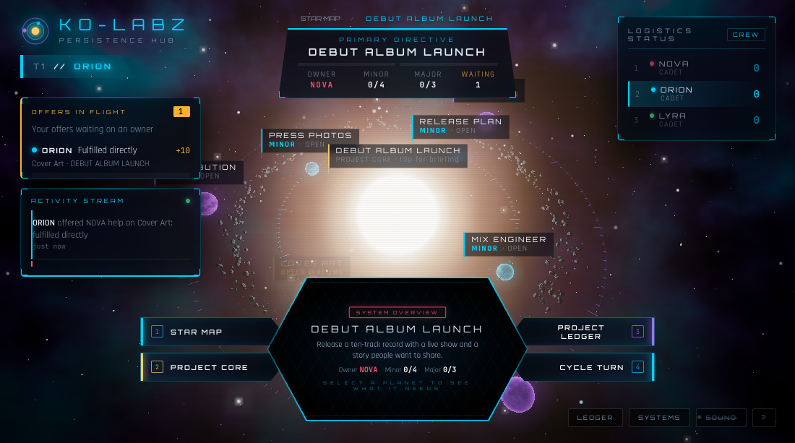
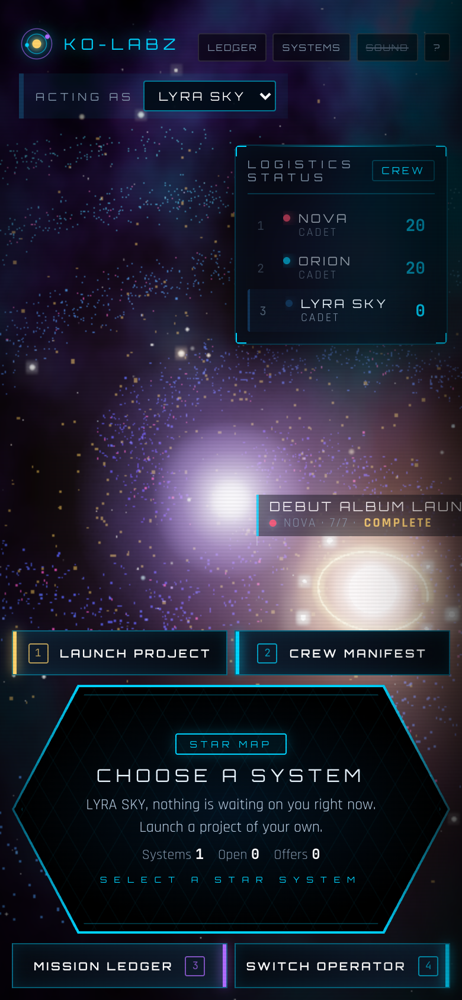

# Ko-Labz Persistence Hub

**A crew game for finishing real projects together, on a 3D star map.**



Every project is a star system. The project is the sun; what it needs orbits it as
planets: quick wins on the inner **minor ring**, big lifts on the outer **major ring**.
Crew members help each other's projects in one of three ways:

| how | what you send | points (minor / major) |
|---|---|---|
| Fulfill directly | a proof link and what you did | 10 / 25 |
| Source a connection | who can help and how to reach them | 7 / 17 |
| Add a solution | how you would meet the need | 4 / 10 |

The owner reviews each offer. Accepting one turns the planet white with a moon in the
helper's colour, pays the points, and keeps the proof, contact or idea in the
**Mission Ledger** for good. Closing a ring pays the closer +10. When every planet is met
the system goes supernova and the owner earns +20. Eight badges and six ranks
(Cadet to Admiral) come from what you actually did.



## Run it

Needs [Node.js](https://nodejs.org) 20 or newer.

```bash
npm install
npm start          # http://127.0.0.1:8350
```

On a Mac you can instead double-click **Start Ko-Labz.command**, which starts the hub and
opens it in Chrome. The first screen sets up the crew and the first project; four templates
(space station, album launch, food forest, product launch) get you going in a click.

To let phones on the same Wi-Fi join, double-click **Start Ko-Labz on Wi-Fi.command**
(or run `KOLABZ_HOST=0.0.0.0 npm start`). Every open screen updates live. Anyone on that
network can play and edit, so use it on a network you trust.

## Play

- **Turns** (default): one crew member at the helm; Cycle Turn passes it on. Owners review
  offers and change their own project on their turn.
- **Free play** (Systems panel): everyone acts any time and picks who they are on their own screen.
- **Owner review** can be switched off so offers count instantly.
- Projects can be edited, archived, restored or deleted by their owner; needs can be added,
  renamed, resolved, reopened and removed.

Keys: `1-4` console buttons · `[` `]` previous/next planet · `Esc` back · `G` star map ·
`T` cycle turn · `C` crew · `L` ledger · `S` systems · `M` sound · `?` help.
Drag to orbit, scroll or pinch to zoom.

It works on a phone too: the console stacks under the map and pinch zooms.



Graphics has a **Low** setting (Systems panel) for older machines; it switches itself on if
the map runs slowly.

## Avatars (optional)

Ko-Labz is standalone. A crew member can also bring in an avatar, either from a running
Civil X Avatar Forge (`KOLABZ_FORGE_URL`, default `http://127.0.0.1:8330`, checked by its
`/api/whoami` before it is trusted) or from an avatar JSON file. Ko-Labz keeps a summary
only: name, alias, element, guild, level, rank, accent colour and up to 12 skills. It is
stored on the player as `player.avatar`.

## How it is built

No build step and no framework: plain ES modules, [three.js](https://threejs.org) for the
3D, a small Node server, and one JSON file for the save.

| path | what |
|---|---|
| `server.mjs` | static files, `/api/state`, `/api/action`, `/api/events` (live updates), export/import, the avatar bridge |
| `shared/rules.mjs` | the one rulebook: every action, points, badges, ranks, templates, save migration |
| `public/scene.js` | the 3D: galaxy, star systems, shaders, effects, camera |
| `public/app.js` | the HUD, console, panels and setup |
| `data/hub.json` | the saved hub, written after every change; `data/backups/` every 10 minutes, last 30 kept |
| `original/` | the single-file prototype this grew from |

The server is the only thing that decides outcomes; the page sends actions and redraws
whatever the server says. Ports: 8350 app, 8351 browser tests, 8352 unit tests.
`GET /api/whoami` answers `app: ko-labz`, and the server exits with code 3 if its port is taken.

## Tests

```bash
npm test           # rules + a real server against a throwaway data folder
npm run e2e        # drives the real page in headless Chrome: 66 checks, setup to supernova
npm run check      # both
```

The browser test needs Google Chrome installed (or `CHROME_PATH`).
